# Azure Data Warehouse using Azure Synapse Analytics

### End-to-end Medallion Architecture (Bronze → Silver → Gold) with a Star Schema, built on Azure


---

## 1. Project Overview

This project is a **cloud data warehouse built entirely on Azure Synapse Analytics**. Raw sales data in CSV format is ingested into a data lake, cleaned and enriched with Spark, and finally modeled into a **star schema** that is ready for BI tools such as Power BI.

**What it demonstrates**

| Skill | Where it shows up |
|---|---|
| Cloud data warehousing | Synapse workspace, serverless SQL as a logical data warehouse |
| ETL / ELT pipelines | Synapse Pipelines with Copy, Data Flow and Script activities |
| Medallion architecture | Bronze (raw), Silver (cleaned), Gold (business-ready) |
| Big data transformation | Mapping Data Flows running on Spark |
| Data lake and SQL integration | External data sources, external tables, CETAS, OPENROWSET |
| Dimensional modeling | Fact and dimension tables, surrogate keys, star schema |
| Security | Managed identity, RBAC, no keys or secrets in pipelines |

**Business goal:** give analysts a clean, fast, query-friendly model to answer questions such as revenue by country, top products and sales by customer email domain.

---

## 2. Architecture

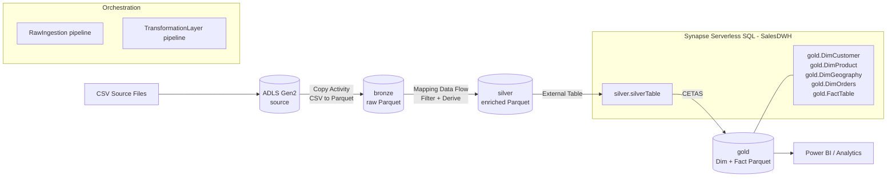

### Layer summary

| Layer | Container | Format | Purpose | Built with |
|---|---|---|---|---|
| Source | `source` | CSV | Raw files as received | Manual upload |
| Bronze | `bronze` | Parquet | Raw, unmodified copy (persistent staging) | Copy Activity |
| Silver | `silver` | Parquet | Filtered and enriched data | Mapping Data Flow (Spark) |
| Gold | `gold` | Parquet | Star schema: dimensions and fact | Serverless SQL, CETAS |

---

## 3. Tech Stack

| Category | Technology |
|---|---|
| Cloud platform | Microsoft Azure (Central India region) |
| Analytics platform | Azure Synapse Analytics |
| Storage | Azure Data Lake Storage Gen2 |
| Orchestration | Synapse Pipelines (Copy, Data Flow, Script activities) |
| Transformation | Mapping Data Flows (Apache Spark) |
| Query engine | Synapse Serverless SQL pool (T-SQL) |
| File format | Parquet (Snappy), Delta (file format defined for reading) |
| Security | Managed Identity, Azure RBAC, Microsoft Entra ID |
| Modeling | Kimball dimensional modeling, Star schema |
| Reporting (target) | Power BI |

---

## 4. Core Concepts (Quick Theory)

<details>
<summary><b>Cloud Data Warehouse</b></summary>

A managed analytical store with **separated storage and compute**, **MPP** (parallel query processing), **columnar storage**, elastic scaling and pay-as-you-go pricing. It is optimized for analytics (OLAP), not transactions (OLTP).

| | OLTP (Azure SQL Database) | OLAP (Synapse Data Warehouse) |
|---|---|---|
| Purpose | Run the business | Analyze the business |
| Workload | Many small reads and writes | Few large analytical queries |
| Design | Normalized (3NF) | Denormalized (star / snowflake) |
| Storage | Row-oriented | Column-oriented |
| Scale | GB to TB | TB to PB |
</details>

<details>
<summary><b>ETL vs ELT</b></summary>

- **ETL:** transform before loading into the target.
- **ELT:** load raw data first, transform inside the target engine.

This project is a hybrid: raw data is loaded into Bronze (EL), Spark transforms it into Silver (T), and SQL (CETAS) models Gold (ELT-style).
</details>

<details>
<summary><b>Staging layer: transient vs persistent</b></summary>

| | Transient staging | Persistent staging |
|---|---|---|
| Data lifetime | Deleted after each load | Retained over time |
| Replay / audit | Weak | Strong |
| Cost | Low | Higher |

The **Bronze layer** here acts as **persistent staging**. The **core layer** (cleaned and modeled data) maps to Silver and Gold.
</details>

<details>
<summary><b>Medallion architecture</b></summary>

| Layer | Quality | Consumers |
|---|---|---|
| Bronze | Raw | Data engineers |
| Silver | Cleaned and conformed | Engineers, data scientists |
| Gold | Business-ready, modeled | Analysts, BI, executives |
</details>

<details>
<summary><b>Incremental loading</b></summary>

Loading **only new or changed data** instead of reloading everything. Common techniques:

- **Watermark column:** store the last loaded value, then query `WHERE col > lastWatermark`.
- **File-based:** filter by last modified time, or process only new files via Get Metadata + ForEach.
- **CDC (Change Data Capture)** at the source.
- **Partition-based:** load only the latest date partition.
- **Triggers:** schedule, tumbling window or storage event.

Always update the watermark **after** a successful load.
</details>

<details>
<summary><b>Serverless SQL, external tables, CETAS, OPENROWSET</b></summary>

- **Serverless SQL pool:** on-demand T-SQL over lake files, billed per TB processed. Stores only metadata.
- **External table:** a SQL table definition over files in the lake (read-only).
- **CETAS:** `CREATE EXTERNAL TABLE AS SELECT` runs a query and **writes the result as Parquet** to the lake.
- **OPENROWSET:** ad hoc query over files without creating any object.

Object creation order: `Master Key → Scoped Credential → External Data Source → External File Format → External Table`.
</details>

<details>
<summary><b>Data modeling: fact, dimension, star vs snowflake</b></summary>

- **Fact table:** numeric measures and foreign keys. Very large and narrow. Defined at a specific **grain**.
- **Dimension table:** descriptive context (who, what, where). Smaller and wide, with a **surrogate key**.
- **Star schema:** fact table joined directly to denormalized dimensions (fewer joins, faster, simpler).
- **Snowflake schema:** dimensions normalized into sub-tables (less redundancy, more joins).

| Measure type | Example |
|---|---|
| Additive | `TotalAmount`, `Quantity` |
| Semi-additive | Account balance |
| Non-additive | `UnitPrice` (average, never sum) |
</details>

<details>
<summary><b>Slowly Changing Dimensions (SCD)</b></summary>

| Type | Behavior |
|---|---|
| Type 1 | Overwrite the old value (no history) |
| Type 2 | Add a new row with start/end dates and a current flag (full history) |
| Type 3 | Add a column holding the previous value |

The Gold dimensions in this project are fully rebuilt on each run (Type 1-like). Type 2 is covered in [Future Improvements](#10-future-improvements).
</details>

---

## 5. Implementation, Step by Step

### Step 1: Create the Azure Synapse Workspace

| Setting | Value |
|---|---|
| Resource group | `VIVEK_RG` |
| Region | Central India |
| Workspace name | `azuredatawarehousing` |
| Primary ADLS Gen2 account | `datalakevivs` |
| File system | `destination` |
| Authentication | Local SQL **and** Microsoft Entra ID |
| SQL admin login | `viv` |

> The workspace's primary storage (`datalakevivs`) is used by Synapse itself. A **separate** storage account (`azurewarehouselake`) holds the project data, which keeps platform data and business data apart.

### Step 2: Data Lake Storage and Access Control

1. Created storage account **`azurewarehouselake`** (ADLS Gen2, hierarchical namespace enabled).
2. Created four containers: `source`, `bronze`, `silver`, `gold`.
3. Granted Synapse access using RBAC:
   **Storage account → Access Control (IAM) → Add role assignment → `Storage Blob Data Contributor` → Managed identity → `azuredatawarehousing`**

**Why this matters:** the Synapse workspace identity has no rights on a new storage account by default. `Storage Blob Data Contributor` is the least-privilege role that allows reading and writing (needed for Copy, Data Flow and CETAS). Using a managed identity means **no keys, SAS tokens or passwords** are stored anywhere.

### Step 3: Bronze Layer (Raw Ingestion)

**Pipeline:** `RawIngestion` → **Copy data** activity

| Component | Name | Details |
|---|---|---|
| Linked service | `LS_Datalake` | ADLS Gen2, system-assigned managed identity, `azurewarehouselake` |
| Source dataset | `DS_rawCSV` | CSV in `source` container, first row as header |
| Sink dataset | `DS_Parquet` | Parquet, same linked service |
| Sink path | `bronze/sales/orderDay0.parquet` | |

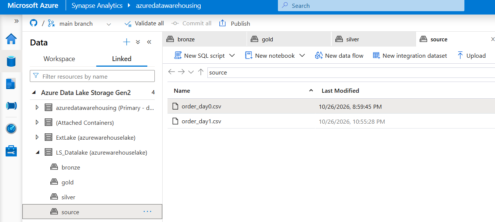

```
source/*.csv  ──(Copy Activity)──►  bronze/sales/orderDay0.parquet
```

- Converts CSV to **Parquet** (smaller, typed and faster for analytics).
- No business logic here: Bronze stays as close to the source as possible.
- One linked service is **reused** by multiple datasets.

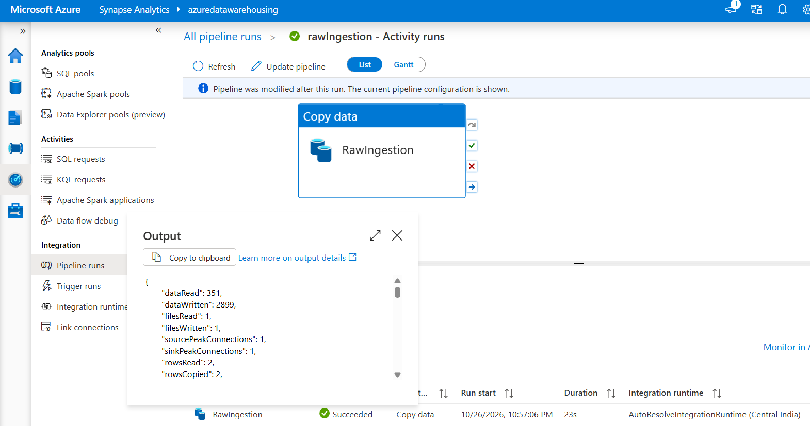

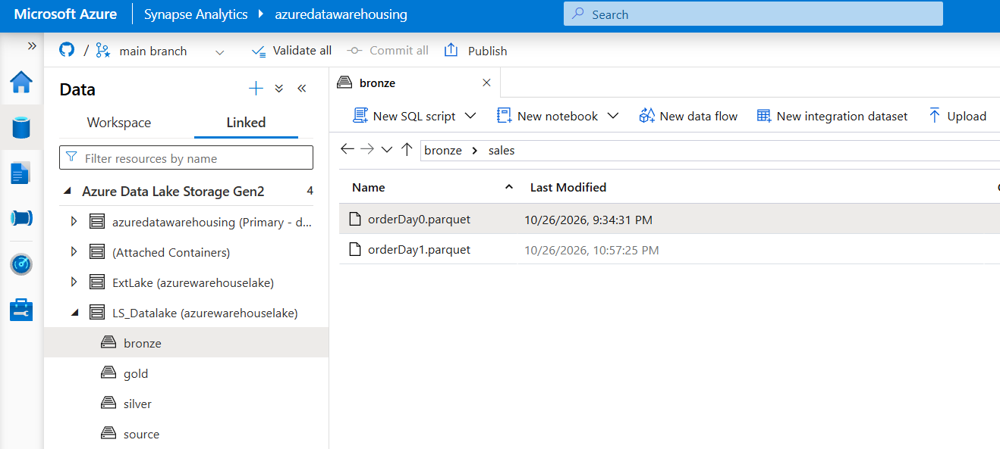

### Step 4: Silver Layer (Transformation)

**Pipeline:** `TransformationLayer` → **Data flow** activity (runs on Spark)

| # | Transformation | Configuration |
|---|---|---|
| 1 | Source | Dataset `DS_ParquetBronze` → `bronze/sales/` (linked service `LS_Datalake`) |
| 2 | Filter | `UnitPrice >= 100` |
| 3 | Derived column `Domain` | `split(CustomerEmail, '@')` (returns an array) |
| 4 | Derived column `FetchDomain` | `slice(Domain, 2)[1]` (extracts the email domain) |
| 5 | Sink `SilverDestination` | Dataset `DS_Silver` → `silver/enriched/` |

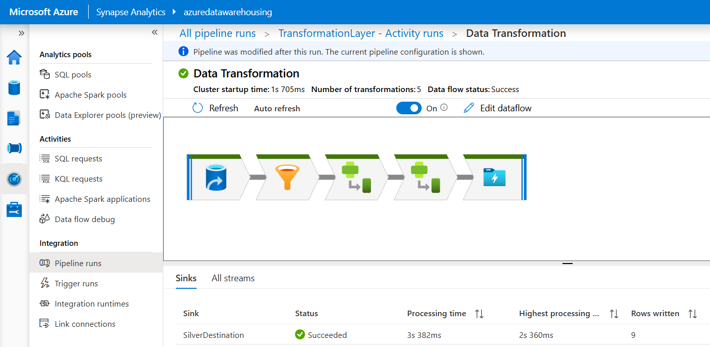

How the email expression works:

```text
CustomerEmail = "john@gmail.com"
split(CustomerEmail,'@')   →  ["john", "gmail.com"]
slice(Domain, 2)           →  ["gmail.com"]
slice(Domain, 2)[1]        →  "gmail.com"      (data flow arrays are 1-indexed)
```

<details>
<summary><b>Equivalent PySpark (for reference)</b></summary>

```python
from pyspark.sql.functions import split, col

df = spark.read.parquet("abfss://bronze@azurewarehouselake.dfs.core.windows.net/sales/")

silver_df = (
    df.filter(col("UnitPrice") >= 100)
      .withColumn("Domain", split(col("CustomerEmail"), "@").getItem(1))   # PySpark arrays are 0-indexed
)

silver_df.write.mode("overwrite").parquet(
    "abfss://silver@azurewarehouselake.dfs.core.windows.net/enriched/"
)
```
</details>

### Step 5: Serverless SQL External Objects

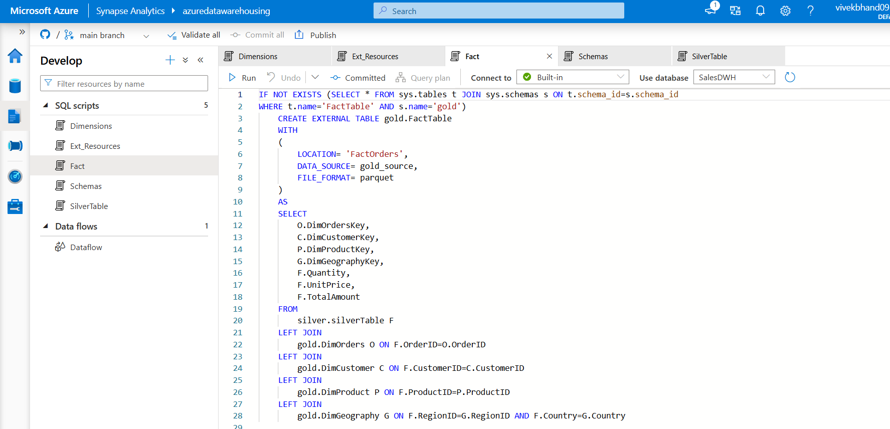

Created a serverless SQL database **`SalesDWH`** and a linked service `ExtLake` (managed identity) to the lake. Script **`Ext_Resources`**:

```sql
-- 1. Master key (protects stored credentials)
CREATE MASTER KEY ENCRYPTION BY PASSWORD = '<strong-password>';

-- 2. Credential: authenticate to storage using the workspace managed identity
CREATE DATABASE SCOPED CREDENTIAL viv_creds
WITH IDENTITY = 'Managed Identity';

-- 3. External data sources: named pointers to lake containers
CREATE EXTERNAL DATA SOURCE silver_source
WITH ( LOCATION = 'https://azurewarehouselake.dfs.core.windows.net/silver/',
       CREDENTIAL = viv_creds );

CREATE EXTERNAL DATA SOURCE gold_source
WITH ( LOCATION = 'https://azurewarehouselake.dfs.core.windows.net/gold/',
       CREDENTIAL = viv_creds );

-- 4. External file formats: how files are encoded
CREATE EXTERNAL FILE FORMAT parquet
WITH ( FORMAT_TYPE = PARQUET,
       DATA_COMPRESSION = 'org.apache.hadoop.io.compress.SnappyCodec' );

CREATE EXTERNAL FILE FORMAT delta
WITH ( FORMAT_TYPE = DELTA );
```

Script **`schemas`**: one schema per layer for organization and security boundaries.

```sql
CREATE SCHEMA silver;
GO
CREATE SCHEMA gold;
```

| Object | Role |
|---|---|
| `viv_creds` | **How** to authenticate (managed identity) |
| `silver_source`, `gold_source` | **Where** the data is |
| `parquet`, `delta` | **How** the files are encoded |
| `silver`, `gold` schemas | Logical grouping and access control |

### Step 6: Expose Silver to SQL

Script **`silverTable`** creates an external table over the Silver Parquet files. It is **idempotent**, so it is safe to rerun:

```sql
IF NOT EXISTS (SELECT * FROM sys.tables t JOIN sys.schemas s ON t.schema_id = s.schema_id
               WHERE t.name = 'SilverTable' AND s.name = 'silver')
    CREATE EXTERNAL TABLE silver.silverTable
    (
        OrderID VARCHAR(100),
        OrderDate DATETIME2,
        CustomerID VARCHAR(100),
        CustomerName VARCHAR(100),
        CustomerEmail VARCHAR(100),
        ProductID VARCHAR(100),
        ProductName VARCHAR(100),
        ProductCategory VARCHAR(100),
        RegionID VARCHAR(100),
        Country VARCHAR(100),
        Quantity VARCHAR(100),
        UnitPrice INT,
        TotalAmount INT,
        Domain VARCHAR(100)
    )
    WITH
    (
        LOCATION    = 'enrichedSales',   -- must match the folder the data flow sink writes to
        DATA_SOURCE = silver_source,
        FILE_FORMAT = parquet
    );
```

This script is attached to the `TransformationLayer` pipeline as a **Script activity** that runs **only after the Data Flow succeeds** (success dependency). It uses a new linked service `LS_Serverless` (Azure Synapse Analytics, serverless endpoint, database `SalesDWH`).

```
[ Data Flow: Filter → Derive → Derive → Sink ]  ──on success──►  [ Script: create silver.silverTable ]
```
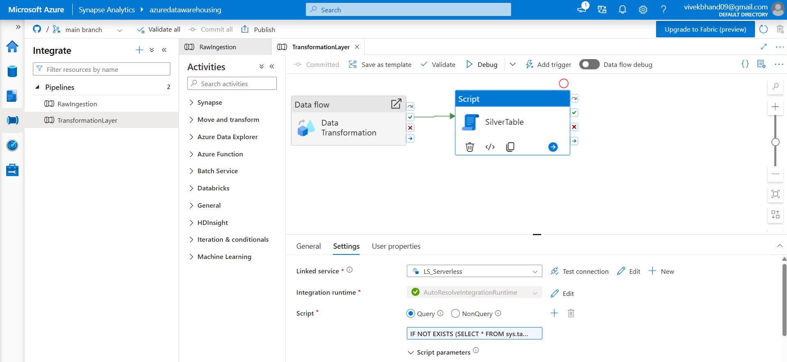

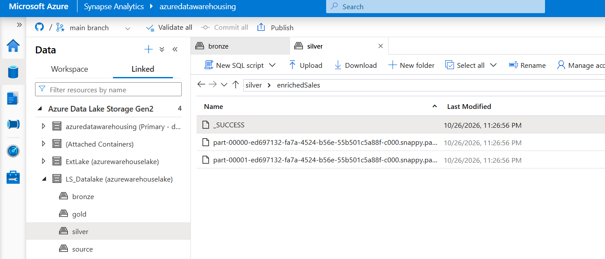

**Silver layer complete:** the data is cleaned, enriched and queryable with SQL.

### Step 7: Gold Layer, Dimension Tables

Script **`dimensions`** uses **CETAS**. Each dimension is built from `SELECT DISTINCT` on Silver plus a **surrogate key** generated with `ROW_NUMBER()`.

```sql
-- DimCustomer
IF NOT EXISTS (SELECT * FROM sys.tables t JOIN sys.schemas s ON t.schema_id = s.schema_id
               WHERE t.name = 'DimCustomer' AND s.name = 'gold')
    CREATE EXTERNAL TABLE gold.DimCustomer
    WITH ( LOCATION = 'DimCustomer', DATA_SOURCE = gold_source, FILE_FORMAT = parquet )
    AS
    SELECT *, ROW_NUMBER() OVER (ORDER BY T.CustomerID) AS DimCustomerKey
    FROM ( SELECT DISTINCT CustomerID, CustomerName, CustomerEmail, Domain
           FROM silver.silverTable ) T;
```

The same pattern is used for the other dimensions:

| Dimension | Source columns (`SELECT DISTINCT`) | Surrogate key | Output folder |
|---|---|---|---|
| `gold.DimCustomer` | CustomerID, CustomerName, CustomerEmail, Domain | `DimCustomerKey` | `gold/DimCustomer` |
| `gold.DimProduct` | ProductID, ProductName, ProductCategory | `DimProductKey` | `gold/DimProduct` |
| `gold.DimGeography` | RegionID, Country | `DimGeographyKey` | `gold/DimGeography` |
| `gold.DimOrders` | OrderID plus order context columns | `DimOrdersKey` | `gold/DimOrders` |

<details>
<summary><b>View the DimProduct, DimGeography and DimOrders scripts</b></summary>

```sql
-- DimProduct
CREATE EXTERNAL TABLE gold.DimProduct
WITH ( LOCATION = 'DimProduct', DATA_SOURCE = gold_source, FILE_FORMAT = parquet )
AS
SELECT *, ROW_NUMBER() OVER (ORDER BY T2.ProductID) AS DimProductKey
FROM ( SELECT DISTINCT ProductID, ProductName, ProductCategory
       FROM silver.silverTable ) T2;

-- DimGeography
CREATE EXTERNAL TABLE gold.DimGeography
WITH ( LOCATION = 'DimGeography', DATA_SOURCE = gold_source, FILE_FORMAT = parquet )
AS
SELECT *, ROW_NUMBER() OVER (ORDER BY T3.RegionID) AS DimGeographyKey
FROM ( SELECT DISTINCT RegionID, Country FROM silver.silverTable ) T3;

-- DimOrders
CREATE EXTERNAL TABLE gold.DimOrders
WITH ( LOCATION = 'DimOrders', DATA_SOURCE = gold_source, FILE_FORMAT = parquet )
AS
SELECT *, ROW_NUMBER() OVER (ORDER BY T4.OrderID) AS DimOrdersKey
FROM ( SELECT DISTINCT OrderID, CustomerID, CustomerName, CustomerEmail, Domain,
                       ProductID, ProductName, ProductCategory, RegionID, Country
       FROM silver.silverTable ) T4;
```

Each script is wrapped in the same `IF NOT EXISTS` guard shown above.
</details>

### Step 8: Gold Layer, Fact Table

Script **`Fact`** looks up the **surrogate key** of every dimension and keeps only keys and measures:

```sql
IF NOT EXISTS (SELECT * FROM sys.tables t JOIN sys.schemas s ON t.schema_id = s.schema_id
               WHERE t.name = 'FactTable' AND s.name = 'gold')
    CREATE EXTERNAL TABLE gold.FactTable
    WITH ( LOCATION = 'FactOrders', DATA_SOURCE = gold_source, FILE_FORMAT = parquet )
    AS
    SELECT
        O.DimOrdersKey,
        C.DimCustomerKey,
        P.DimProductKey,
        G.DimGeographyKey,
        F.Quantity,
        F.UnitPrice,
        F.TotalAmount
    FROM silver.silverTable F
    LEFT JOIN gold.DimOrders    O ON F.OrderID    = O.OrderID
    LEFT JOIN gold.DimCustomer  C ON F.CustomerID = C.CustomerID
    LEFT JOIN gold.DimProduct   P ON F.ProductID  = P.ProductID
    LEFT JOIN gold.DimGeography G ON F.RegionID   = G.RegionID AND F.Country = G.Country;
```

- **Grain:** one row per order line.
- **LEFT JOIN** keeps every transaction even if a dimension match is missing (no silent row loss).
- The fact stores **only integers and numbers**, which makes it compact and fast.

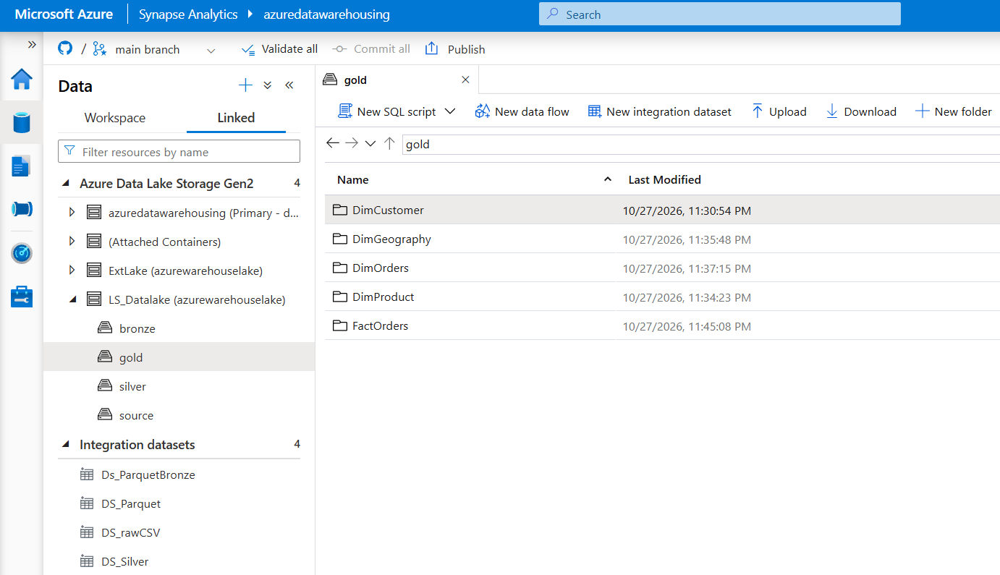

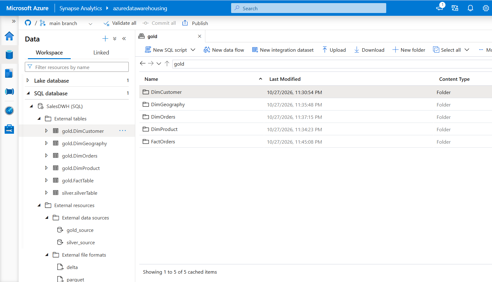

**Gold layer complete.**

---

## 6. Data Model (Star Schema)

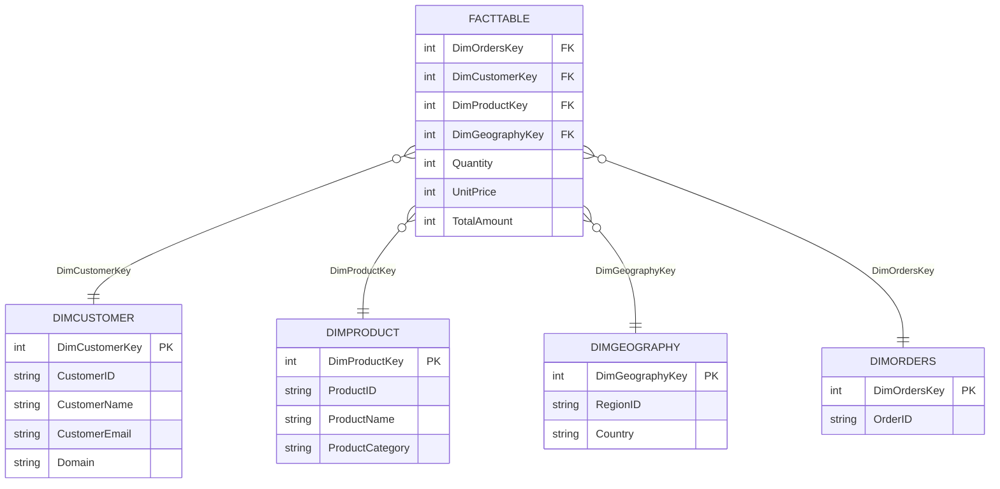

> In serverless SQL, primary and foreign keys are **logical only** (not enforced). Integrity is ensured by the ETL logic and validation queries.

---

## 7. Sample Analytics Queries

```sql
-- Revenue by country
SELECT g.Country, SUM(f.TotalAmount) AS Revenue
FROM gold.FactTable f
JOIN gold.DimGeography g ON f.DimGeographyKey = g.DimGeographyKey
GROUP BY g.Country
ORDER BY Revenue DESC;

-- Top 5 products by units sold
SELECT TOP 5 p.ProductName, SUM(f.Quantity) AS Units
FROM gold.FactTable f
JOIN gold.DimProduct p ON f.DimProductKey = p.DimProductKey
GROUP BY p.ProductName
ORDER BY Units DESC;

-- Revenue by customer email domain
SELECT c.Domain, SUM(f.TotalAmount) AS Revenue
FROM gold.FactTable f
JOIN gold.DimCustomer c ON f.DimCustomerKey = c.DimCustomerKey
GROUP BY c.Domain
ORDER BY Revenue DESC;
```

**Ad hoc exploration with OPENROWSET**

```sql
SELECT TOP 10 *
FROM OPENROWSET(
        BULK 'enriched/*.parquet',
        DATA_SOURCE = 'silver_source',
        FORMAT = 'PARQUET'
     ) AS rows;
```

---

## 8. Key Learnings

- **Cloud data warehouse fundamentals:** separation of storage and compute, MPP, columnar storage, OLTP vs OLAP, and how Azure SQL Database differs from Synapse.
- **Medallion architecture:** why raw (Bronze), cleaned (Silver) and modeled (Gold) layers make pipelines reusable and replayable.
- **Persistent staging:** keeping raw data enables reprocessing without re-hitting the source.
- **Secure by design:** managed identity plus RBAC removes the need to store credentials. Least-privilege roles matter.
- **Pipeline building blocks:** linked services (connections), datasets (data pointers), activities, success dependencies and reuse of connections.
- **Spark data flows:** visual transformations that run on Spark, including data flow expression quirks (1-indexed arrays vs 0-indexed PySpark).
- **Serverless SQL as a logical data warehouse:** external data sources, scoped credentials, file formats, external tables, CETAS and OPENROWSET.
- **Idempotent scripts:** `IF NOT EXISTS` checks against `sys.tables` and `sys.schemas` make reruns safe.
- **Dimensional modeling:** grain, facts vs dimensions, surrogate keys, star vs snowflake, additive vs non-additive measures.
- **Incremental loading and SCD:** watermark, file-based and CDC patterns, plus SCD Types 1, 2 and 3 for tracking history.

---

## 11. Repository Structure

This repository is connected to **Synapse Studio Git integration**, so every published artifact is stored as JSON.

```text
.
├── Utils/                    # Supporting / helper files
├── credential/               # Workspace managed identity credential
├── dataflow/                 # Mapping Data Flow (Filter → Derive → Derive → Sink)
├── dataset/                  # DS_rawCSV, DS_Parquet, DS_ParquetBronze, DS_Silver
├── integrationRuntime/       # Integration runtime used to run activities
├── linkedService/            # LS_Datalake, LS_Serverless, ExtLake
├── pipeline/                 # RawIngestion, TransformationLayer
├── sqlscript/                # Ext_Resources, schemas, silverTable, dimensions, Fact
├── publish_config.json       # Synapse publish configuration
└── README.md
```

| Folder | Contents | Used in |
|---|---|---|
| `pipeline/` | `RawIngestion` (Copy activity), `TransformationLayer` (Data Flow + Script activity) | Bronze and Silver |
| `dataflow/` | Spark-based transformation logic | Silver |
| `dataset/` | Pointers to CSV and Parquet locations in the lake | Bronze and Silver |
| `linkedService/` | Connections to the data lake and serverless SQL (managed identity) | All layers |
| `sqlscript/` | External resources, schemas, silver external table, dimension and fact CETAS scripts | Silver and Gold |
| `credential/` | Workspace managed identity credential | Security |
| `integrationRuntime/` | Compute that runs pipeline activities | Orchestration |
| `publish_config.json` | Tells Synapse which branch holds the published workspace | CI/CD |


---

## 12. How to Reproduce

1. Create an Azure account and a resource group.
2. Create an **Azure Synapse workspace** (with its primary ADLS Gen2 account).
3. Create a second storage account (hierarchical namespace **on**) with containers `source`, `bronze`, `silver`, `gold`.
4. Assign **Storage Blob Data Contributor** on that storage account to the Synapse workspace **managed identity**.
5. Upload a sales CSV to `source`.
6. Create linked services (`LS_Datalake`, `LS_Serverless`), datasets and pipeline **RawIngestion**, then run it.
7. Build the **TransformationLayer** pipeline (Data Flow + Script activity), then run it.
8. Create database `SalesDWH`, then run the SQL scripts in order: `Ext_Resources` → `schemas` → `silverTable` → `dimensions` → `Fact`.
9. Query the `gold.*` tables or connect Power BI to the serverless SQL endpoint.

> **Cost tip:** serverless SQL is billed per data processed, so this project costs very little. Turn off Data Flow debug sessions when idle and delete the resource group when finished.

---

## 13. Author

**Vivek**
Aspiring Azure Data Engineer .

If you found this project useful, consider giving it a star.
